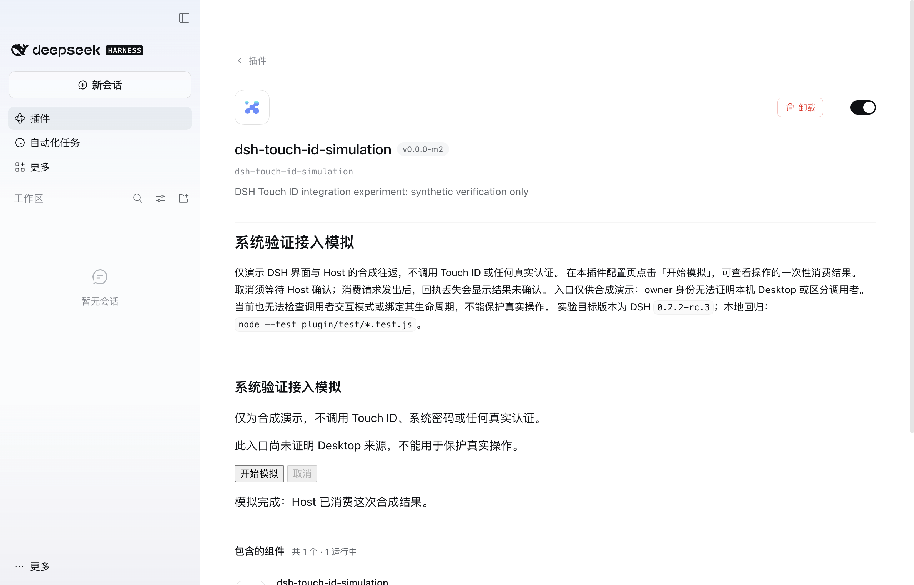

# DSH 身份验证

**非官方实验项目，由社区独立开发和维护。** 为 DeepSeek Harness 探索可信的 macOS 身份验证入口，当前源码版本为 `0.1.0-m3.1`，适配目标为 DSH `0.2.2-rc.3`。

普通插件安装提供无副作用的合成演示。真实系统验证自检依赖本仓库的独立 Desktop 适配层，尚未提供面向日常 DSH 的即装即用原生包。请先在独立测试 profile 中评估。

## 当前能做什么

- 在 DSH 官方插件配置页展示中文入口，经实际 Host 完成合成请求、取消和一次性消费。
- 实验适配层核对登记的原生主窗口与主框架、Renderer 安全设置，通过继承的私有通道绑定调用方、窗口、动作、策略与期限。
- 独立 Swift helper 使用 LocalAuthentication，每次新建上下文，由 macOS 处理凭据。插件只接收这次结果。

已记录一次本人操作后的 `system-owner` 成功自检。系统面板取消、焦点恢复、安装卸载回退、第三方调用接入和跨设备兼容仍待验收。系统策略回执不指明采用了指纹、密码或其他具体认证方式。参见[验证范围](docs/validation.md)。

**会话加密、锁定、解封和毛玻璃隐私界面均为下一阶段计划，当前尚未实现。** 毛玻璃只用于展示，静态数据加密与读取授权需独立设计。参见[下一阶段规格](docs/specs/session-protection.md)和[执行计划](docs/plans/session-protection.md)。

## 集成截图



图为 2026-11-17 的 M2 实际 DSH 集成截图，展示 Host 合成结果的一次性消费，没有调用真实系统认证。图中是早期名称与 `0.0.0-m2` 版本；现名为「DSH 身份验证」。它不证明系统认证或会话加密已完成。

## 在独立 profile 中试用合成插件

要求已有 DSH `0.2.2-rc.3`。从本项目的预发行标签取得源码：

```sh
git clone --branch v0.1.0-m3.1 https://github.com/shaoqing404/dsh-identity-verification.git
cd dsh-identity-verification
```

在**独立测试环境**的 DSH「插件 → 添加插件」中输入本地 `plugin` 子目录的绝对路径。安装后打开「DSH 身份验证」，普通宿主显示「系统验证接入模拟」。它不会自行安装原生 helper 或修改宿主源码。

真实认证的实验组件与准备缺口见[原生实验说明](docs/native-lab.md)。不要用自己的业务会话做迁移或加密测试。

也可在独立测试 profile 启用 DSH 实验性的「自定义插件索引」，在「发现 → 添加索引源」输入：

```text
https://raw.githubusercontent.com/shaoqing404/dsh-identity-verification/main/market/index.json
```

这是本项目自建索引，不是官方收录目录。索引固定源码提交并声明精确兼容版本，卡片安装仍只提供合成演示。索引格式已用 DSH `0.2.2-rc.3` 的官方解析器校验，发现页的实际安装体验仍待单独验收。

## 开发验证

Node.js 24.9+，无需安装 npm 依赖即可运行纯逻辑测试：

```sh
node --test plugin/test/*.test.js scripts/test/native-auth-channel.test.mjs native/tests/runner.test.mjs native/tests/source-guard.test.mjs
```

缺少本机 `.lab` 上游运行时时，三个官方 Connection 集成用例会明确跳过，其余用例仍运行。macOS 上的 helper 构建和无弹窗检查见 [native/README.md](native/README.md)。测试通过不替代本人认证或产品验收。

## 源码结构

| 路径 | 用途 |
| --- | --- |
| `plugin/` | 遵循 DSH bundle 规范的插件、中文配置页、合成核心和私有通道核心 |
| `native/` | 独立 LocalAuthentication helper 和纯逻辑测试 |
| `scripts/` | 实验适配、来源检查、进程生命周期与隔离启动源码 |
| `docs/` | 边界、验证记录与后续设计 |

MIT License。欢迎提交可复现的问题和改进，参见 [CONTRIBUTING.md](CONTRIBUTING.md) 与 [SECURITY.md](SECURITY.md)。DeepSeek Harness 的名称与商标归各自所有者，本项目不代表 DeepSeek 官方。
