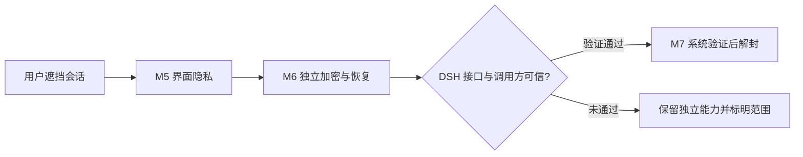

# 会话隐私与加密保护：下一阶段计划

状态：**方案候选，未实施**。本计划接在[会话保护规格](../specs/session-protection.md)之后使用，不改变[现有 M3](../validation.md) 和 M4 的状态。可先研究接口和设计；实机认证整合须等 M3 整体验收完成，社区发布另按 M4 和发布流程推进。

## 目标与顺序

让用户知道会话何时只是遮挡、何时已有可恢复的静态加密、何时验证后解封。按「界面隐私 → 独立可恢复加密 → 可信解封整合」推进；每一步都在独立 DSH 实验环境使用合成会话。

## M5：会话隐私与界面加封

**任务**：盘点可接入的会话界面和生命周期，做手动遮挡与可配置自动遮挡的原型；设计明文可见、已遮挡、执行中和不支持的状态。先确认空闲、锁屏、睡眠、工作区切换、退出和恢复事件能否可靠取得。未完成的会话写入或后台任务不被擅自终止。

**交付**：界面及无障碍原型、目标版本接口清单、遮挡范围和未覆盖项。毛玻璃仅作可选装饰；降低透明度、效果不可用和高对比度场景有不透明回退。无法可靠隐藏正文或无障碍内容时显示不支持。

**验收**：用合成会话逐项检查正文、标题、预览、选择复制、无障碍树、键盘和焦点；检查触发、恢复与快速切换竞态。能清楚看出「已遮挡」不等于「已加密」。接口或视图无法控制时，该部分记为未完成。

## M6：可恢复加密与迁移演练

**任务**：对比目标版本的持久化后端、单会话选择和独立加密容器，确认 append/flush/关闭等契约；设计密钥生命周期、带认证的存储格式、异常恢复及备份导出。先实现只处理合成会话的独立加密原型，选择经审查的密码库；设计独立恢复材料及其安全保管，先证明能恢复再考虑迁移。

**交付**：可复核的覆盖矩阵、格式和密钥设计、离线恢复及导入导出演练、真实会话迁移方案。迁移方案须保留原件，明确核验与切换点；旧明文、外部附件、备份和模型上下文单独列明。

**验收**：在隔离数据目录核对正确解密、错误密钥、密文和元数据篡改、截断/乱序、重复写入、模拟断电或进程中断前后恢复、格式版本拒绝，以及恢复材料丢失和异机演练。用合成标记检查声明范围内的存储、日志与导出；验证覆盖不了的索引、附件或备份在界面上如实说明。完整快照回滚能否检测须单独验证，不由认证加密测试推断。失败不覆盖原件，不输出未经校验的明文。

## M7：验证后解封整合与验收

**前提**：M3 已按现有计划完成全部验收；M6 加密与恢复演练通过；目标 DSH 版本已证明可接入并覆盖所声明的数据。验证器只负责当前请求的认证，受保护存储负责密钥和会话。

**任务**：为调用方登记动作和权限，绑定窗口、会话、用途、请求 ID 与期限；将 Keychain 受控密钥访问绑定到解封动作。实现锁定、自动封存、认证取消、超时、窗口销毁和迟到回执的状态处理。确认密钥访问、持久化关闭和会话恢复能以正确次序完成。

**验收**：合成会话验证并发、跨调用方、重放、无效来源、崩溃和恢复，确保认证成功不变成可复用的全局通行证；按独立环境手册由项目维护者亲自完成真实成功和取消、系统后备策略与焦点恢复，记录设备、系统、DSH 和构建版本。应用重启、锁屏/睡眠恢复及有未完成工作的情况均要单独验收。插件同 Host 权限、系统策略或发行方式不满足要求时停止扩大安全声明。

## 必须先回答的问题

| 决定 | 何时确定 | 负责人 |
| --- | --- | --- |
| 哪些会话需要保护；自动遮挡/封存的触发项、默认值和等待时间 | M5 交互评审 | 项目维护者与项目主控 |
| DSH 目标版本是否支持后端装配、按会话保护、可靠遮挡和暂停/恢复；附件、索引、日志等由谁负责 | M5 接口核验，M6 前定范围 | 项目主控 |
| 恢复材料形式、离线保管、丢失处理、导出默认值及是否允许明文导出 | M6 安全设计评审 | 项目维护者与项目主控 |
| Keychain 访问控制、签名/访问组、设备绑定和系统后备策略如何组合 | M7 前完成实机验证与安全评审 | 项目主控 |
| 是否允许迁移真实会话及何时切换、保留或清理旧副本 | 隔离恢复验收后另行决定 | 项目维护者 |

## 验证与回退

基线回归使用项目现有的 `node --test plugin/test/*.test.js`；各阶段新增命令随实现写入，不将基线通过视为新能力验收。先执行纯合成测试，再按[隔离桌面手册](../native-lab.md)核对目录、进程和版本，最后进行本人实机操作。记录源码完成、隔离测试、安装和人工验收，分别给出结果。

失败时停止对应步骤，保留原会话或加密包及恢复证据；读取、写入、导出或切换状态无法确认时先核对，不自动覆盖或删除。隔离测试只使用本项目合成材料，不接触日常环境和真实业务数据。若 DSH 接口无法满足门槛，停止原生整合并保留独立原型，待上游能力或方案改变后再评估。

2026-11-17：建立规格和阶段计划；尚无本计划范围内的实现或验收结果。
